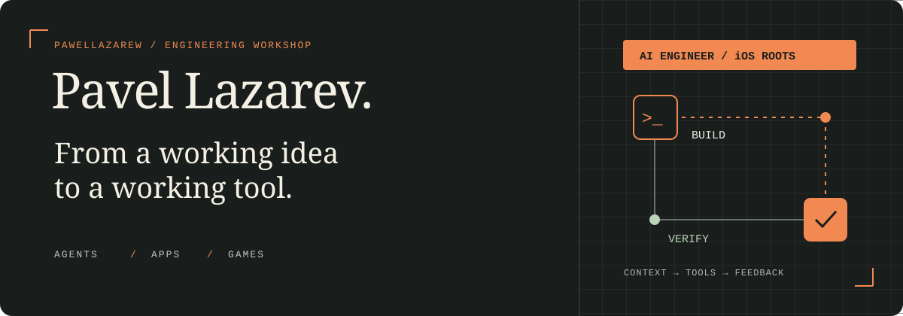

<p align="center">
  
</p>

I'm **Pavel**, an AI Engineer with a decade of iOS experience. I build the tools around coding agents: the context they receive, the actions they can take, and the checks that tell us whether their work holds up.

My side projects are where I put those ideas to work — built with help from LLMs, tested through real applications and games.

### On my workbench

| | Project | What it does |
| :--- | :--- | :--- |
| **01** | **[Pult ↗](https://github.com/pawellazarew/pult)** | A desktop app and CLI for running Claude Code and Codex agents. Parallel conversations, persistent sessions and one Inbox for permission requests. |
| **02** | **[gamedev-forge ↗](https://github.com/pawellazarew/gamedev-forge)** | A feedback loop for game development: browser checks, scripted play, screenshots, performance measurements and balance simulations. Plus Blender tools for model previews and sprite atlases. |

### The part I find interesting

Getting an agent to write code is a start. Giving it enough context to make a good decision — and enough feedback to catch a bad one — is where I spend my time.

```text
              context          tools          evidence
                 │               │               │
  idea ──────► build ──────► run & inspect ──────► ship
                 ▲               │
                 └─── improve ───┘
```

**AI engineering** · Agent workflows, knowledge delivery, cross-model review and behavioral evaluations.

**App development** · Swift, SwiftUI and UIKit; TypeScript, Node.js, React and Electron in my own tools.

**Game experiments** · Browser games, procedural systems and tools that let agents play and inspect what they build.

---

[Website](https://pawellazarew.github.io/) · [Email](mailto:pawellazarew@gmail.com) · [Telegram](https://t.me/pavellazarev_ios_developer) · English / Русский
